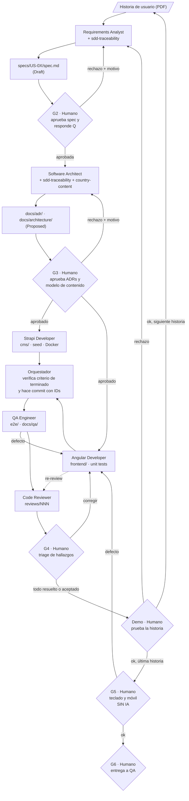

# FLOW.md — Flujo agéntico

> **Estado: aprobado en G1 (2026-11-22), documento vivo.** Las secciones 6–8 se completan con lo que ocurra realmente durante el proyecto; no se rellenan por adelantado.

Cómo una historia de usuario funcional pasa a un incremento listo para QA, quién interviene en cada paso y dónde decide una persona.

## 1. Herramienta y por qué

**Claude Code** (app de escritorio, sesión local), modelo del orquestador **Claude Opus 5.5** (`claude-opus-5-5`). Los subagentes heredan el modelo (`model: inherit`, decisión G1-b).

Motivos (D1):

- Subagentes (`.claude/agents/`) y Skills (`.claude/skills/`) se definen como archivos versionados y se cargan de forma nativa, con herramientas permitidas por agente.
- `CLAUDE.md` se carga automáticamente en el orquestador y en los subagentes: un único contexto que gobierna la generación.
- Ejecuta en la máquina real: Docker, Node, Playwright y Git, de modo que tests y arranque se verifican con salida real.
- Las transcripciones originales quedan como JSONL en local y se pueden copiar sin editar a `logs/sessions/` (requisito de logs sin editar).
- Hooks para convertir reglas críticas en controles deterministas: `.claude/settings.json` bloquea `Write`/`Edit` en `logs/` (G1-a).

La Fase 1 se hizo en claude.ai porque aún no estaba el entorno local; allí no había daemon de Docker, que es uno de los motivos del cambio.

## 2. Actores

| Actor | Tipo | Responsabilidad | Definición |
|---|---|---|---|
| Humano (Jorge) | Persona | Aprueba o rechaza en cada gate, responde preguntas abiertas, prueba manual sin IA | — |
| Orquestador | Sesión principal de Claude Code | Planifica, delega, verifica el criterio de terminado, hace commits, registra decisiones | `CLAUDE.md` |
| Requirements Analyst | Subagente | Historia → spec verificable | [.claude/agents/requirements-analyst.md](.claude/agents/requirements-analyst.md) |
| Software Architect | Subagente | ADRs, modelo de contenido, contratos de API | [.claude/agents/software-architect.md](.claude/agents/software-architect.md) |
| Strapi Developer | Subagente | `cms/`, seed, permisos, Docker y nginx | [.claude/agents/strapi-developer.md](.claude/agents/strapi-developer.md) |
| Angular Developer | Subagente | `frontend/` + unit tests | [.claude/agents/angular-developer.md](.claude/agents/angular-developer.md) |
| QA Engineer | Subagente | Plan de pruebas, e2e, informe | [.claude/agents/qa-engineer.md](.claude/agents/qa-engineer.md) |
| Code Reviewer | Subagente | Review independiente incl. seguridad | [.claude/agents/code-reviewer.md](.claude/agents/code-reviewer.md) |
| `sdd-traceability` | Skill | IDs, plantillas y procedimientos SDD | [.claude/skills/sdd-traceability/SKILL.md](.claude/skills/sdd-traceability/SKILL.md) |
| `country-content` | Skill | Procedimiento de contenido por país de punta a punta | [.claude/skills/country-content/SKILL.md](.claude/skills/country-content/SKILL.md) |

Los subagentes no se llaman entre sí ni hacen commit: todo pasa por el orquestador, que es el único punto de integración.

## 3. Diagrama

Cada decisión humana (aprobación, rechazo y motivo literal) queda en [`docs/decision-log.md`](docs/decision-log.md).

## 4. Paso a paso

| Paso | Descripción | ¿IA? | IA, agente, subagente o skill | Entregable | Humano en el bucle |
|---|---|---|---|---|---|
| 0. Análisis | Leer el PDF, proponer arquitectura, equipo de agentes, riesgos y decisiones. Arranque del proyecto. | Sí | claude.ai (Fase 1) + Claude Code, orquestador (verificación local) | `docs/phase-1/analysis.md` | **G0**: aprueba D1–D11. Rechazo → el orquestador reformula la decisión. |
| 1. Diseño del flujo | Crear el contexto global, los subagentes, las Skills y este documento. Lo hace el orquestador porque los agentes aún no existen. | Sí | Claude Code, orquestador | `CLAUDE.md`, `.claude/agents/`, `.claude/skills/`, `FLOW.md` | **G1**: aprueba el flujo. Rechazo → el orquestador ajusta y se registra el motivo. |
| 2. Spec | Convertir la historia en REQ, AC Gherkin y preguntas abiertas con propuesta. | Sí | Subagente `requirements-analyst` + Skill `sdd-traceability` | `specs/US-0X/spec.md` | **G2**: aprueba la spec y responde cada `Q`. Rechazo → vuelve al analista con el motivo. Ninguna historia se implementa sin G2. |
| 2b. Revisión cruzada de specs | Comparar las specs entre sí antes de G2: las escribe en paralelo una instancia del analista por historia, que no ve las otras. | Sí | Orquestador | `reviews/000-G2-specs-cross-consistency.md` | Los hallazgos se presentan en G2 como decisiones; las correcciones vuelven al analista de cada spec y el orquestador hace una re-review. |
| 3. Arquitectura | ADRs con alternativas reales, modelo de contenido, contratos de API. | Sí | Subagente `software-architect` + Skills `sdd-traceability`, `country-content` | `docs/adr/`, `docs/architecture/` | **G3**: aprueba ADRs y modelo. Rechazo → vuelve al arquitecto. |
| 4. Implementación CMS | Content types, seed CO/CL, permisos mínimos, Docker y nginx. | Sí | Subagente `strapi-developer` + Skill `country-content` | `cms/`, `docker-compose.yml`, `.env.example` | El orquestador verifica el criterio de terminado; el humano lo ve en la demo. |
| 5. Implementación frontend | Componentes, store, validadores y unit tests de la historia. | Sí | Subagente `angular-developer` + Skills | `frontend/`, `docs/qa/US-0X-test-report.md` | El orquestador re-ejecuta build y tests antes de hacer commit. |
| 6. Verificación e2e | Plan de pruebas desde los AC y e2e con Playwright. | Sí | Subagente `qa-engineer` | `e2e/`, `docs/qa/test-plan.md`, `docs/qa/e2e-report.md` | Defectos → vuelven al desarrollador. |
| 7. Code review | Review independiente contra spec, ADRs y checklist de seguridad. | Sí | Subagente `code-reviewer` + Skill `sdd-traceability` | `reviews/NNN-US-0X-*.md` | — |
| 8. Triage | Decidir cada hallazgo: corregir, aceptar o rechazar. | **No** | — | Tabla de resolución del informe + `docs/decision-log.md` | **G4**: el humano decide. Corregir → desarrollador → re-review. |
| 9. Demo | Probar la historia en la app real antes de pasar a la siguiente. | **No** | — | Entrada en `docs/decision-log.md` | Rechazo → vuelve a la spec o al desarrollador según la causa. |
| 10. Prueba manual | Recorrer el wizard solo con teclado y en ancho móvil. | **No** | — | `docs/qa/manual-check.md` | **G5**: el humano ejecuta y firma. Defecto → desarrollador. |
| 11. Trazabilidad y logs | Actualizar la matriz y exportar la transcripción de la sesión: copia íntegra salvo la redacción de datos personales (G1-f), con hashes. | Sí | Orquestador + Skill `sdd-traceability` + `scripts/export-session-logs.ps1` | `docs/traceability.md`, `logs/sessions/`, `docs/logs-manifest.md` | El humano decide qué se redacta (G1-f) y comprueba la matriz en G6. |
| 12. Entrega a QA | README, FLOW y `docker compose up` verificado desde cero. | Sí | Orquestador | `README.md`, `FLOW.md` | **G6**: aprueba la entrega. |

## 5. Mecanismo de trazabilidad

- IDs `US → REQ → AC → ADR → F → Dn` definidos en la Skill `sdd-traceability`.
- Commits con IDs en el asunto: `feat(frontend): ... [US-01][REQ-01.3]`; correcciones con el hallazgo `[F-01.4]`.
- Tests nombrados por AC: `grep -r "AC-02.4"` lleva de la spec al test.
- Matriz por REQ en [`docs/traceability.md`](docs/traceability.md).
- Decisiones y rechazos humanos en [`docs/decision-log.md`](docs/decision-log.md).

## 6. Si lo usara un equipo de 5 personas

*Pendiente: se completa al final con la experiencia real del proyecto.*

## 7. Qué no funcionó como se esperaba y cómo se ajustó

*Se registra durante el proyecto.*

- **Entorno de la Fase 1.** Se hizo en claude.ai sin daemon de Docker; se movió a Claude Code local (D1) y se re-verificó el entorno, lo que cambió la recomendación de D5.
- **Carga de subagentes a mitad de sesión (2026-11-22).** Las Skills creadas durante la sesión se cargaron al momento, pero la primera prueba de humo de `code-reviewer` falló con `Agent type 'code-reviewer' not found`. Los archivos eran correctos (frontmatter en la línea 1, sin BOM). Más tarde, en la misma sesión, los 6 agentes aparecieron disponibles sin reiniciar: la carga tuvo retraso. Ajuste: no delegar en un agente recién creado sin una prueba de humo previa.
- **`CLAUDE.md` no llega a los subagentes (2026-11-22).** La prueba de humo de los 6 agentes confirmó herramientas y Skills correctas (`code-reviewer` sin `Edit`), pero los 6 respondieron que no tenían `CLAUDE.md` en contexto. Como el contexto global es la base del flujo, se añadió a cada agente un paso 0 obligatorio: leer `CLAUDE.md` con `Read` antes de actuar. Re-prueba con `code-reviewer`: lo leyó y respondió correctamente sobre la sección 6, los commits y `logs/`.
- **Hook de `logs/` (G1-a).** Probado con entradas simuladas (5 casos) y en real: un `Write` sobre `logs/sessions/.gitkeep` fue rechazado por el hook.
- **Specs en paralelo (Fase 3).** Tres instancias de `requirements-analyst` escribieron US-01, US-02 y US-03 a la vez para ganar tiempo. Cada una resolvió sola los temas compartidos, y salieron 6 inconsistencias (p. ej. roles de campo frente a un booleano `masked` para el documento). Ajuste: se añadió el paso 2b (revisión cruzada del orquestador antes de G2) y las 60 preguntas abiertas se agruparon en 13 decisiones para el humano. La re-review encontró una séptima inconsistencia (F-00.7) causada por la redacción ambigua del propio orquestador en G2-2.
- **Integración y límites de uso (Fase 4).** El trabajo en paralelo de `strapi-developer` y `angular-developer` sin pisarse funcionó, pero la CSP de ADR-0003 rompió los estilos al juntar las dos partes: el CSS crítico de Angular inyecta un `<script>` en línea. Solo apareció al integrar, no en los unit tests (corregido en `b22d2ad`). Además, la sesión llegó al límite de uso a mitad de la fase y un subagente quedó cortado antes de crear nada; se reanudó con el mismo agente y con los comandos largos en segundo plano. Se añadió a cada fase la verificación de integración del orquestador.
- **Datos personales en las transcripciones (G1-f).** La revisión previa a copiar los logs encontró el email del autor (contexto que añade Claude Code). El humano decidió redactar solo esa cadena; se creó `scripts/export-session-logs.ps1` con lista de redacción fuera del repo, sin sobrescritura y con hashes en `docs/logs-manifest.md`. El script falló dos veces en Windows PowerShell 5.1 (sin BOM corrompía los acentos; `$PSScriptRoot` vacío en los valores por defecto de `param`); ambas causas se analizaron y corrigieron antes de exportar.

## 8. Dónde se decidió no usar IA

- **Gates G0–G6:** las aprobaciones y rechazos son humanos; la IA solo prepara la información.
- **Triage de hallazgos (G4):** decidir si un hallazgo se corrige o se acepta es una decisión de riesgo del humano.
- **Prueba manual de teclado y móvil (G5):** comprobación independiente de lo que la IA afirma.
- *Se completa durante el proyecto.*
