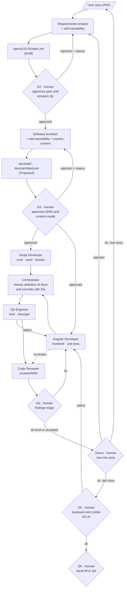

# FLOW.md — Agentic flow

> **Status: approved in G1 (2026-11-22), living document.** Sections 6–8 were filled in with what actually happened during the project, not in advance. Translated into English on 2026-11-23 (D16).

How a functional user story becomes a QA-ready increment, who takes part in each step, and where a person decides.

## 1. Tool and why

**Claude Code** (desktop app, local session). The orchestrator runs on **Claude Opus 5.5** (`claude-opus-5-5`). Subagents inherit the model (`model: inherit`, decision G1-b).

Reasons (D1):

- Subagents (`.claude/agents/`) and Skills (`.claude/skills/`) are versioned files loaded natively, with allowed tools set per agent.
- `CLAUDE.md` is the single global context that governs generation. Subagents read it explicitly as step 0 (§7).
- It runs on the real machine (Docker, Node, Playwright, Git), so tests and start-up are verified with real output.
- The original transcripts stay as local JSONL and can be copied unedited into `logs/sessions/` (unedited-logs requirement).
- Hooks turn critical rules into deterministic controls: `.claude/settings.json` blocks `Write`/`Edit` under `logs/` (G1-a).

Phase 1 was done in claude.ai because the local environment was not ready yet. There was no Docker daemon there, which is one of the reasons for the switch.

## 2. Actors

| Actor | Type | Responsibility | Definition |
|---|---|---|---|
| Human (Jorge) | Person | Approves or rejects at each gate, answers open questions, runs the manual check without AI | — |
| Orchestrator | Main Claude Code session | Plans, delegates, checks the definition of done, commits, records decisions | `CLAUDE.md` |
| Requirements Analyst | Subagent | Story → verifiable spec | [.claude/agents/requirements-analyst.md](.claude/agents/requirements-analyst.md) |
| Software Architect | Subagent | ADRs, content model, API contracts | [.claude/agents/software-architect.md](.claude/agents/software-architect.md) |
| Strapi Developer | Subagent | `cms/`, seed, permissions, Docker and nginx | [.claude/agents/strapi-developer.md](.claude/agents/strapi-developer.md) |
| Angular Developer | Subagent | `frontend/` + unit tests | [.claude/agents/angular-developer.md](.claude/agents/angular-developer.md) |
| QA Engineer | Subagent | Test plan, e2e, report | [.claude/agents/qa-engineer.md](.claude/agents/qa-engineer.md) |
| Code Reviewer | Subagent | Independent review, security included | [.claude/agents/code-reviewer.md](.claude/agents/code-reviewer.md) |
| `sdd-traceability` | Skill | IDs, templates and SDD procedures | [.claude/skills/sdd-traceability/SKILL.md](.claude/skills/sdd-traceability/SKILL.md) |
| `country-content` | Skill | End-to-end procedure for country content | [.claude/skills/country-content/SKILL.md](.claude/skills/country-content/SKILL.md) |

Subagents never call each other and never commit. Everything goes through the orchestrator, which is the only integration point.

## 3. Diagram

Every human decision (approval, rejection and literal reason) is recorded in [`docs/decision-log.md`](docs/decision-log.md).

## 4. Step by step

| Step | Description | AI? | AI, agent, subagent or skill | Deliverable | Human in the loop |
|---|---|---|---|---|---|
| 0. Analysis | Read the PDF; propose architecture, agent team, risks and decisions. Project bootstrap. | Yes | claude.ai (Phase 1) + Claude Code orchestrator (local verification) | `docs/phase-1/analysis.md` | **G0**: approves D1–D11. Rejection → the orchestrator reworks the decision. |
| 1. Flow design | Create the global context, the subagents, the Skills and this document. The orchestrator does it because the agents do not exist yet. | Yes | Claude Code orchestrator | `CLAUDE.md`, `.claude/agents/`, `.claude/skills/`, `FLOW.md` | **G1**: approves the flow. Rejection → the orchestrator adjusts it and the reason is recorded. |
| 2. Spec | Turn the story into REQs, Gherkin ACs and open questions with a proposal. | Yes | `requirements-analyst` subagent + `sdd-traceability` Skill | `specs/US-0X/spec.md` | **G2**: approves the spec and answers each `Q`. Rejection → back to the analyst with the reason. No story is implemented without G2. |
| 2b. Cross-spec review | Compare the specs before G2: one analyst instance per story writes them in parallel, and none sees the others. | Yes | Orchestrator | `reviews/000-G2-specs-cross-consistency.md` | Findings are presented in G2 as decisions; fixes go back to each spec's analyst and the orchestrator re-reviews. |
| 3. Architecture | ADRs with real alternatives, content model, API contracts. | Yes | `software-architect` subagent + `sdd-traceability`, `country-content` Skills | `docs/adr/`, `docs/architecture/` | **G3**: approves ADRs and model. Rejection → back to the architect. |
| 4. CMS implementation | Content types, CO/CL seed, minimal permissions, Docker and nginx. | Yes | `strapi-developer` subagent + `country-content` Skill | `cms/`, `docker-compose.yml`, `.env.example` | The orchestrator checks the definition of done; the human sees it in the demo. |
| 5. Frontend implementation | Components, store, validators and unit tests of the story. | Yes | `angular-developer` subagent + Skills | `frontend/`, `docs/qa/US-0X-test-report.md` | The orchestrator re-runs build and tests before committing. |
| 6. E2E verification | Test plan from the ACs and Playwright e2e. | Yes | `qa-engineer` subagent | `e2e/`, `docs/qa/test-plan.md`, `docs/qa/e2e-report.md` | Defects → back to the developer. |
| 7. Code review | Independent review against spec, ADRs and a security checklist. | Yes | `code-reviewer` subagent + `sdd-traceability` Skill | `reviews/NNN-*.md` | — |
| 8. Triage | Decide each finding: fix, accept or reject. | **No** | — | Resolution table in the report + `docs/decision-log.md` | **G4**: the human decides. Fix → developer → re-review. |
| 9. Demo | Try the story in the real app before moving to the next one. | **No** | — | Entry in `docs/decision-log.md` | Rejection → back to the spec or the developer, depending on the cause. |
| 10. Manual check | Go through the wizard with the keyboard only and at mobile width. | **No** | — | `docs/qa/manual-check.md` | **G5**: the human runs and signs it. Defect → developer. |
| 11. Traceability and logs | Update the matrix and export the session transcript: a full copy except the redaction of personal data (G1-f), with hashes. | Yes | Orchestrator + `sdd-traceability` Skill + `scripts/export-session-logs.ps1` | `docs/traceability.md`, `logs/sessions/`, `docs/logs-manifest.md` | The human decides what is redacted (G1-f) and checks the matrix in G6. |
| 12. Hand-off to QA | README, FLOW and `docker compose up` verified from scratch. | Yes | Orchestrator | `README.md`, `FLOW.md` | **G6**: approves the delivery. |

## 5. Traceability mechanism

- IDs `US → REQ → AC → ADR → F → Dn`, defined in the `sdd-traceability` Skill.
- Commits carry IDs in the subject: `feat(frontend): ... [US-01][REQ-01.3]`; fixes carry the finding: `[F-01.4]`.
- Tests are named after their AC: `grep -r "AC-02.4"` leads from the spec to the test.
- Matrix per REQ in [`docs/traceability.md`](docs/traceability.md).
- Human decisions and rejections in [`docs/decision-log.md`](docs/decision-log.md).

## 6. If a team of 5 used it

What would change, based on what worked and failed here:

- **People own paths, not only agents.** The agents' path ownership (`.claude/agents/`) would move into `CODEOWNERS`. For example: two people on `frontend/`, one on `cms/` and `infra/`, one QA on `e2e/` and `docs/qa/`, and a tech lead on `specs/`, `docs/adr/` and the gates. Each person would use the same subagents in their own area.
- **Gates inside the Git flow.** G2 and G3 would be PRs of specs and ADRs with mandatory approval from product and the tech lead. G4 would be the review in the PR itself, with findings as comments and the resolution linked. G6 would be a release. `decision-log.md` would remain the source for what does not fit in a PR.
- **Mandatory CI.** Unit, build and e2e on every PR, on a runner with fixed resources. Here the local e2e runs were sensitive to the machine's load (§7).
- **Parallel specs with one owner of cross-cutting topics.** Here three parallel specs produced 7 inconsistencies (§7). With 5 people, one person would settle the shared topics (field roles, fixed texts, persistence) before splitting the stories.
- **A shared Strapi environment for real content changes,** besides interception in the e2e: business and QA would try them as in part 4 of G5.
- **Skills as team knowledge.** `sdd-traceability` and `country-content` would be the onboarding guide. Changing a Skill would go through review, like code.
- **What does not scale the same way:** a single orchestrator reviewing every diff is a bottleneck. With 5 people, each one reviews their agents' diffs and the orchestrator keeps integration and the gates.

## 7. What did not work as expected and how it was adjusted

- **Phase 1 environment.** It was done in claude.ai without a Docker daemon. It moved to local Claude Code (D1) and the environment was re-verified, which changed the recommendation of D5.
- **Subagents loading mid-session (2026-11-22).** Skills created during the session loaded at once, but the first smoke test of `code-reviewer` failed with `Agent type 'code-reviewer' not found`. The files were correct (frontmatter on line 1, no BOM). Later in the same session the 6 agents became available without a restart: loading was delayed. Adjustment: never delegate to a freshly created agent without a smoke test.
- **`CLAUDE.md` does not reach subagents (2026-11-22).** The smoke test of the 6 agents confirmed the right tools and Skills (`code-reviewer` without `Edit`), but all 6 answered that they did not have `CLAUDE.md` in context. Since the global context is the base of the flow, a mandatory step 0 was added to each agent: read `CLAUDE.md` with `Read` before acting. Re-test with `code-reviewer`: it read it and answered correctly about section 6, commits and `logs/`.
- **`logs/` hook (G1-a).** Tested with simulated inputs (5 cases) and for real: a `Write` on `logs/sessions/.gitkeep` was rejected by the hook.
- **Parallel specs (Phase 3).** Three `requirements-analyst` instances wrote US-01, US-02 and US-03 at the same time to save time. Each one settled the shared topics on its own, and 6 inconsistencies came out (e.g. field roles versus a `masked` boolean for the document). Adjustment: step 2b was added (cross-review by the orchestrator before G2), and the 60 open questions were grouped into 13 decisions for the human. The re-review found a seventh inconsistency (F-00.7), caused by the orchestrator's own ambiguous wording in G2-2.
- **Integration and usage limits (Phase 4).** `strapi-developer` and `angular-developer` worked in parallel without stepping on each other, but the CSP of ADR-0003 broke the styles when the two parts were joined: Angular's critical CSS injects an inline `<script>`. It only showed up at integration, not in unit tests (fixed in `b22d2ad`). The session also hit its usage limit mid-phase and a subagent was cut off before creating anything; it resumed with the same agent and with long commands in the background. The orchestrator's integration check was added to every phase.
- **Late visual redesign (D12–D14, after G5).** After G5 the human asked for a look close to SURA's site. Real effects:
  - With the new animations, two full e2e runs took 7.6 min instead of 4.0 and had intermittent failures ("error de carga", the app's 10 s timeout with Strapi under load), each time in different tests. The orchestrator blamed the animations and ran the e2e with `reducedMotion` (77/77). Review 003 (F-00.15) showed the cause had **not** been isolated: the reviewer ran the suite with animations and got 80/80. `reducedMotion` was removed and the suite re-run with animations (`docs/qa/e2e-report.md`). Lesson: a mitigation that makes the suite green is not a proven cause.
  - The D14 content change required an idempotent backfill of the already seeded volume, because the seed never touched existing countries.
  - Two agents rebuilt containers at the same time and collided on the container name. Adjustment: the orchestrator serializes Docker operations.
  - A design change after G5 partly invalidates that manual check, so review 003 covered everything after it and the human repeats a short G5 (F-00.16).
- **Documentation language (D16).** `CLAUDE.md` set documentation in Spanish (G1). On the last day the human showed the recruiter's email asking for the assessment to be answered in English. Five agents translated their own paths in parallel, each checking ID counts before and after so that no content was lost. Lesson: confirm the delivery language at G0.
- **Personal data in the transcripts (G1-f).** The check before copying the logs found the author's email (context added by Claude Code). The human decided to redact only that string. `scripts/export-session-logs.ps1` was created, with the redaction list outside the repo, no overwriting and hashes in `docs/logs-manifest.md`. The script failed twice on Windows PowerShell 5.1: without a BOM it corrupted accents, and `$PSScriptRoot` was empty in `param` defaults. Both causes were analysed and fixed before exporting.

## 8. Where we decided not to use AI

- **Gates G0–G6:** approvals and rejections are human; the AI only prepares the information.
- **Findings triage (G4):** deciding whether a finding is fixed or accepted is the human's risk decision.
- **Keyboard and mobile manual check (G5):** an independent check of what the AI claims. Its first result pasted the orchestrator's example text; the orchestrator did not record it until the human gave the real confirmation.
- **Scope and priorities:** the human rejected extras proposed by the AI (a third country via e2e, CI, several UX improvements) because of the time left (D15). Deciding what not to build is a product decision.
- **Visual identity:** the logo, the favicon and the style direction (D12, D13, D15) were provided and decided by the human. The AI measured the reference site's palette and applied it, but did not copy the proprietary font or the illustrations.
- **Credentials and the Strapi admin:** the human creates the superadmin and makes any real change in the admin. The AI never logs in with their credentials.
- **Merges and publication:** merging each PR, the public visibility of the repository (D1) and sending it to the recruiter belong to the human.
- **Exporting the Phase 1 conversation (claude.ai):** only the human can do it from their account.
