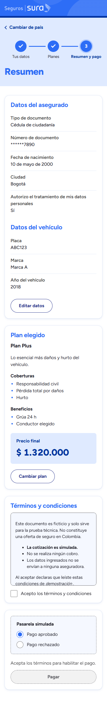
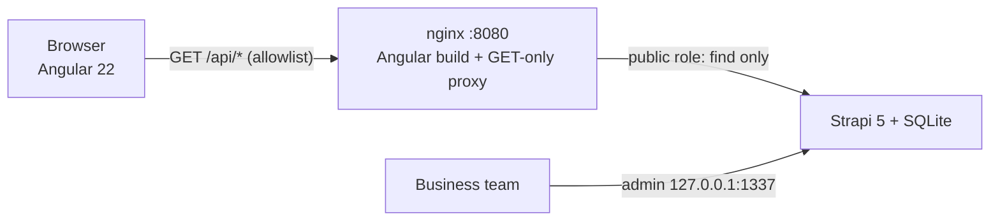

# Multi-country car insurance quote (Colombia and Chile)

Front-end technical assessment: a **single Angular build** that quotes car insurance for **Colombia (`/co`)** and **Chile (`/cl`)**. It reads from **Strapi** the form, plans, price factors, terms and every text of each country. It was built with a **supervised agentic flow**: 6 subagents, 2 Skills, specs, ADRs, reviews and human gates G0 to G6. The flow is described in [`FLOW.md`](FLOW.md).

| Home | Plans | Summary (mobile) |
|---|---|---|
|  |  |  |

> 100 % fictitious data. Payment is simulated: no real gateway and no card fields (PDF, D9). The visual style is inspired by SURA because the assessment is for SURA (D12, D13); the logo and favicon were provided by the author and are used for presentation only. The end-user texts are in Spanish because the users are in Colombia and Chile; they come from Strapi.

## Start with a single command

Requirements: **Docker** with Docker Compose v2, and ports 8080 and 1337 free.

```powershell
docker compose up --build
```

- **App:** http://localhost:8080 (Colombia at `/co`, Chile at `/cl`).
- **Strapi admin** (for the business team): http://127.0.0.1:1337/admin. It only listens on `127.0.0.1`. The superadmin is created with fictitious data on first access; no administrator is seeded.
- **No `.env` needed:** `docker-compose.yml` loads [`.env.example`](.env.example), which only holds fictitious values. A local `.env`, never versioned, overrides it.
- The Colombia and Chile seed and the public role permissions are applied idempotently on every start.

To start from scratch, run `docker compose down -v`, which deletes the Strapi volume.

## Tests

| Type | Command | Verified result |
|---|---|---|
| Unit (Vitest + jsdom) | `cd frontend; npm ci; npx ng test --watch=false` | 469/469 ([`docs/qa/`](docs/qa/)) |
| E2E (Playwright, system Chrome) against the Docker stack | `docker compose up -d --build`, then `cd e2e; npm ci; npx playwright test` | 80/80 ([`docs/qa/e2e-report.md`](docs/qa/e2e-report.md)) |
| Manual, without AI (keyboard, mobile, real change in the admin) | [`docs/qa/manual-check.md`](docs/qa/manual-check.md) | G5 approved |

The e2e covers:
- the full flow of both countries;
- loading, error and empty states;
- content changes in Strapi (by interception, G3-3);
- keyboard use and viewports of 320, 375 and 1280 px.

## Basic architecture



- **Multi-country ([ADR-0001](docs/adr/0001-multi-country-strategy.md)):** a `Country` collection with its relations in Strapi, and the country in the URL. The code has nothing hard-coded for CO or CL: currencies, rules, texts and plans come from Strapi.
- **Frontend:**
  - Angular 22 standalone and zoneless, with signals, `@if`/`@for`, OnPush and `strict` TypeScript, no NgModules.
  - Dynamic form with Signal Forms ([ADR-0002](docs/adr/0002-dynamic-form-with-signal-forms.md)).
  - Lazy routes with guards.
  - Wizard state in `sessionStorage`, separated by country ([ADR-0004](docs/adr/0004-wizard-state-persistence-and-navigation.md)).
- **Price:** a pure function, `Math.round(basePrice × Π multipliers)`, with factors per country in Strapi ([ADR-0005](docs/adr/0005-configurable-price-rule.md), [`pricing-rule.md`](docs/architecture/pricing-rule.md)).
- **Security ([ADR-0003](docs/adr/0003-strapi-access-and-security.md)):**
  - The public role only has `find`, and no token reaches the browser.
  - nginx only lets `GET`/`HEAD` through on an exact allowlist and strips `Authorization` and `Cookie`.
  - Strict CSP.
  - Drafts are never served.
- **Terms:** rich text rendered safely ([ADR-0006](docs/adr/0006-terms-rich-text-safe-rendering.md)).
- **Tests:** strategy in [ADR-0007](docs/adr/0007-test-strategy.md).
- More detail in [`docs/architecture/`](docs/architecture/): overview, content model and API contracts.

## Where to find each thing

| What | Where |
|---|---|
| Global context for agents | [`CLAUDE.md`](CLAUDE.md) |
| Agentic flow with diagram | [`FLOW.md`](FLOW.md) |
| Subagents (6) | [`.claude/agents/`](.claude/agents/) |
| Skills (`sdd-traceability`, `country-content`) | [`.claude/skills/`](.claude/skills/) |
| Specs for US-01, US-02 and US-03 | [`specs/`](specs/) |
| ADRs | [`docs/adr/`](docs/adr/) |
| Human decisions (D1–D16, gates G0–G5) | [`docs/decision-log.md`](docs/decision-log.md) |
| Code reviews and their resolution | [`reviews/`](reviews/) |
| Traceability matrix US → REQ → AC → ADR → code → tests → review | [`docs/traceability.md`](docs/traceability.md) |
| Test reports | [`docs/qa/`](docs/qa/) |
| Original, unedited session transcripts (hashes in [`docs/logs-manifest.md`](docs/logs-manifest.md)) | [`logs/sessions/`](logs/sessions/) |
| Code | [`frontend/`](frontend/), [`cms/`](cms/), [`infra/nginx/`](infra/nginx/), [`e2e/`](e2e/) |

The documentation was written in Spanish during the project and translated into English on the last day at the recruiter's request (D16). The human's literal quotes in the decision log and the session transcripts keep their original Spanish.

## Requirements not met and known limitations

- **Payment in a duplicated tab:** without a backend (D4), nothing prevents paying the same quote in two tabs. Within one tab, double click, held Enter, going back and reloading never repeat the payment (REQ-03.23).
- **Quote numbers:** they are only probabilistically unique (cryptographic randomness in the browser), because there is no central registry (REQ-03.26).
- **Per-section "cargando" announcement with a screen reader (F-00.14):** accepted in the G4 triage. G5 did not explicitly confirm it with a screen reader.
- **ACs without e2e:** 7 acceptance criteria are covered by unit tests only; the list and the reasons are in [`docs/qa/test-plan.md`](docs/qa/test-plan.md).
- **No CI:** the e2e runs locally against Docker. On the verified machine (8 GB) it uses 2 workers, because with more load Strapi exceeded the app's 10 s timeout ([`docs/qa/e2e-report.md`](docs/qa/e2e-report.md)).
- **Content changes:** the configuration loads once per app load. To see a change published in Strapi you reload the page, which is what the PDF's criterion asks for.
- **Strapi superadmin:** not seeded; it is created on first access to the admin.
- **Typeface:** Figtree (OFL), self-hosted, instead of `SuraSans`, which is proprietary and is not copied (D13).
- **Plan card text:** since the whole plan card is clickable (D14), its text cannot be selected with the mouse (F-02.2, accepted).
