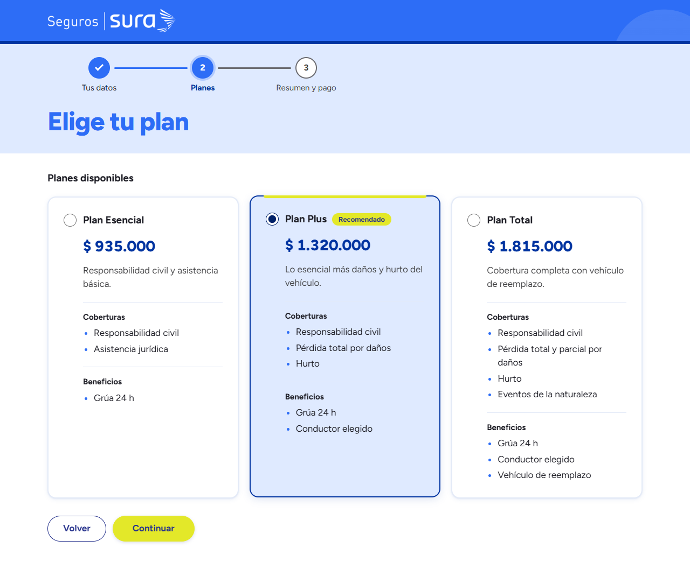
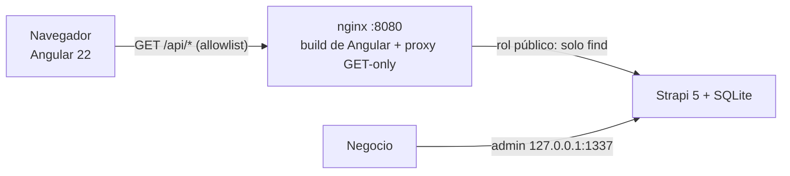

# Cotizador de seguro de auto multipaís (Colombia y Chile)

Prueba técnica de Frontend: un **único build de Angular** que cotiza un seguro de auto para **Colombia (`/co`)** y **Chile (`/cl`)**. Lee de **Strapi** el formulario, los planes, los factores de precio, los términos y todos los textos de cada país. Se construyó con un **flujo agéntico supervisado**: 6 subagentes, 2 Skills, specs, ADRs, reviews y gates humanos G0 a G6. El flujo está en [`FLOW.md`](FLOW.md).

| Inicio | Planes | Resumen (móvil) |
|---|---|---|
|  |  |  |

> Datos 100 % ficticios. El pago es simulado: no hay pasarela real ni campos de tarjeta (PDF, D9). El estilo visual se inspira en SURA porque la prueba es para SURA (D12, D13). El logo y el favicon los aportó el autor y se usan solo como presentación.

## Arranque con un solo comando

Requisitos: **Docker** con Docker Compose v2 y los puertos 8080 y 1337 libres.

```powershell
docker compose up --build
```

- **App:** http://localhost:8080 (Colombia en `/co` y Chile en `/cl`).
- **Admin de Strapi** (para el negocio): http://127.0.0.1:1337/admin. Solo escucha en `127.0.0.1`. En el primer acceso se crea el superadmin con datos ficticios; no hay administrador sembrado.
- No hace falta `.env`: `docker-compose.yml` carga [`.env.example`](.env.example), que solo tiene valores ficticios. Un `.env` local, que nunca se versiona, lo sobrescribe.
- El seed de Colombia y Chile y los permisos del rol público se aplican de forma idempotente en cada arranque.

Para empezar de cero, ejecuta `docker compose down -v`, que borra el volumen de Strapi.

## Pruebas

| Tipo | Comando | Resultado verificado |
|---|---|---|
| Unit (Vitest + jsdom) | `cd frontend; npm ci; npx ng test --watch=false` | 469/469 ([`docs/qa/`](docs/qa/)) |
| E2E (Playwright, Chrome del sistema) contra la pila de Docker | `docker compose up -d --build`, luego `cd e2e; npm ci; npx playwright test` | 80/80 ([`docs/qa/e2e-report.md`](docs/qa/e2e-report.md)) |
| Manual sin IA (teclado, móvil, cambio real en el admin) | [`docs/qa/manual-check.md`](docs/qa/manual-check.md) | G5 aprobada |

El e2e incluye el flujo completo de los dos países, los estados de carga, error y vacío, los cambios de contenido en Strapi (por intercepción, G3-3), y el uso con teclado y en viewports de 320, 375 y 1280 px.

## Arquitectura básica



- **Multipaís ([ADR-0001](docs/adr/0001-multi-country-strategy.md)):** colección `Country` con sus relaciones en Strapi y el país en la URL. El código no tiene nada fijo para CO ni CL: monedas, reglas, textos y planes llegan de Strapi.
- **Frontend:**
  - Angular 22 standalone, zoneless, con signals, `@if`/`@for`, OnPush y TypeScript `strict`, sin NgModules.
  - Formulario dinámico con Signal Forms ([ADR-0002](docs/adr/0002-dynamic-form-with-signal-forms.md)).
  - Rutas *lazy* con guards.
  - Estado del wizard en `sessionStorage`, separado por país ([ADR-0004](docs/adr/0004-wizard-state-persistence-and-navigation.md)).
- **Precio:** función pura `Math.round(basePrice × Π multiplicadores)` con factores por país en Strapi ([ADR-0005](docs/adr/0005-configurable-price-rule.md), [`pricing-rule.md`](docs/architecture/pricing-rule.md)).
- **Seguridad ([ADR-0003](docs/adr/0003-strapi-access-and-security.md)):**
  - El rol público solo tiene `find`, y ningún token llega al navegador.
  - nginx deja pasar solo `GET`/`HEAD` sobre una allowlist exacta y quita `Authorization` y `Cookie`.
  - CSP estricta.
  - Los borradores no se publican.
- **Términos:** texto enriquecido renderizado de forma segura ([ADR-0006](docs/adr/0006-terms-rich-text-safe-rendering.md)).
- **Pruebas:** estrategia en [ADR-0007](docs/adr/0007-test-strategy.md).
- Más detalle en [`docs/architecture/`](docs/architecture/): visión general, modelo de contenido y contratos de API.

## Dónde está cada cosa

| Qué | Dónde |
|---|---|
| Contexto global para agentes | [`CLAUDE.md`](CLAUDE.md) |
| Flujo agéntico con diagrama | [`FLOW.md`](FLOW.md) |
| Subagentes (6) | [`.claude/agents/`](.claude/agents/) |
| Skills (`sdd-traceability`, `country-content`) | [`.claude/skills/`](.claude/skills/) |
| Specs de US-01, US-02 y US-03 | [`specs/`](specs/) |
| ADRs | [`docs/adr/`](docs/adr/) |
| Decisiones humanas (D1–D15, gates G0–G5) | [`docs/decision-log.md`](docs/decision-log.md) |
| Reviews y su resolución | [`reviews/`](reviews/) |
| Matriz de trazabilidad US → REQ → AC → ADR → código → tests → review | [`docs/traceability.md`](docs/traceability.md) |
| Informes de pruebas | [`docs/qa/`](docs/qa/) |
| Transcripciones originales sin editar (hashes en [`docs/logs-manifest.md`](docs/logs-manifest.md)) | [`logs/sessions/`](logs/sessions/) |
| Código | [`frontend/`](frontend/), [`cms/`](cms/), [`infra/nginx/`](infra/nginx/), [`e2e/`](e2e/) |

## Requisitos no cumplidos y limitaciones conocidas

- **Pago en una pestaña duplicada:** sin backend (D4), nada impide pagar la misma cotización en dos pestañas. Dentro de una pestaña, el doble clic, el Enter mantenido, volver atrás y recargar no repiten el pago (REQ-03.23).
- **Números de cotización:** son únicos solo de forma probabilística (aleatoriedad criptográfica del navegador), porque no hay registro central (REQ-03.26).
- **Anuncio de "cargando" por sección con lector de pantalla (F-00.14):** se aceptó en el triage G4. En G5 no se confirmó de forma explícita con un lector de pantalla.
- **AC sin e2e:** 7 criterios están cubiertos solo por unit tests; la lista y el motivo están en [`docs/qa/test-plan.md`](docs/qa/test-plan.md).
- **E2E sin integración continua:** se ejecutan en local contra Docker. En el equipo verificado (8 GB) se usan 2 workers y `reducedMotion`, porque con más carga Strapi superaba el timeout de 10 s de la app ([`docs/qa/e2e-report.md`](docs/qa/e2e-report.md)).
- **Cambios de contenido:** la configuración se carga una vez por carga de la app. Para ver un cambio publicado en Strapi hay que recargar la página, que es lo que pide el criterio del PDF.
- **Superadmin de Strapi:** no se siembra; se crea en el primer acceso al admin.
- **Tipografía:** se usa Figtree (OFL), autoalojada, en lugar de `SuraSans`, que es propietaria y no se copia (D13).
