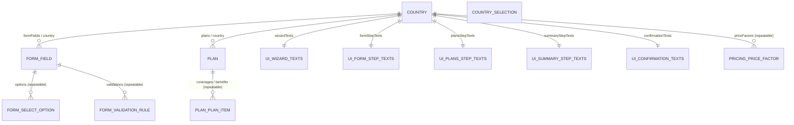

# Strapi content model

| Field | Value |
|---|---|
| Status | Accepted (2026-11-22, G3) |
| Date | 2026-11-22 |
| Author | Software Architect (subagent) |
| Decisions | D3, D4, D8 · G2-1, G2-2, G2-4, G2-6, G2-7, G2-8 · ADR-0001, ADR-0002, ADR-0003, ADR-0005, ADR-0006 |
| Strapi version | 5.63.0 (SQLite) |

The names in this document are **the final ones** that the Strapi Developer and the Angular Developer will use: they replace the tentative names in the specs. Attributes are in camelCase (English, `CLAUDE.md` §11). `locale`, `status`, `meta` and `document` are reserved in Strapi 5 and are not used.

## 1. Summary

| UID | Type | Draft & Publish | i18n | Public route |
|---|---|---|---|---|
| `api::country.country` | Collection type (`countries`) | Yes | No | `GET /api/countries` |
| `api::form-field.form-field` | Collection type (`form-fields`) | Yes | No | `GET /api/form-fields` |
| `api::plan.plan` | Collection type (`plans`) | Yes | No | `GET /api/plans` |
| `api::country-selection.country-selection` | Single type (`country-selection`) | Yes | No | `GET /api/country-selection` |

Components: `form.select-option`, `form.validation-rule`, `plan.plan-item`, `pricing.price-factor`, `ui.wizard-texts`, `ui.form-step-texts`, `ui.plans-step-texts`, `ui.summary-step-texts`, `ui.confirmation-texts`.

**"Required"** in the tables = `required: true` in the Strapi schema, which the admin checks on publish. The app **validates each value anyway** (tables 5.3 of US-01 and REQ-02.25), because the contract can change and the e2e tests simulate impossible data by interception (ADR-0007).

## 2. Content types

### 2.1 `country` (collection type)

A country's market data, interface texts, price factors and terms (ADR-0001).

| Attribute | Type | Required | Constraints | Use (REQ) |
|---|---|---|---|---|
| `code` | string | Yes | `unique: true`, `regex: ^[a-z]{2}$` | URL segment, filter, storage keys, quote number prefix (REQ-01.1, REQ-03.26) |
| `name` | string | Yes | `maxLength: 60` | `/` list and "país no disponible" (REQ-01.2) |
| `intlLocale` | string | Yes | `regex: ^[a-z]{2}-[A-Z]{2}$` (e.g. `es-CO`) | `Intl.NumberFormat` and `Intl.DateTimeFormat`, `localeCompare` (REQ-02.4, REQ-02.6, REQ-03.3) |
| `currency` | string | Yes | `regex: ^[A-Z]{3}$` (ISO 4217) | Formatting and match with the plan currency (REQ-02.6, REQ-02.7) |
| `minimumAge` | integer | Yes | `min: 0`, `max: 120` (seed 18) | Legal age (REQ-01.20, G2-4) |
| `wizardTexts` | component `ui.wizard-texts` (single) | Yes | — | Common texts (§3.5) |
| `formStepTexts` | component `ui.form-step-texts` | Yes | — | Step 1 (REQ-01.13) |
| `plansStepTexts` | component `ui.plans-step-texts` | Yes | — | Step 2 (REQ-02.32) |
| `summaryStepTexts` | component `ui.summary-step-texts` | Yes | — | Step 3 (REQ-03.38) |
| `confirmationTexts` | component `ui.confirmation-texts` | Yes | — | Confirmation (REQ-03.27, REQ-03.38) |
| `priceFactors` | component `pricing.price-factor` (repeatable) | No | Order = array order | Price rule (ADR-0005, REQ-02.9) |
| `termsAndConditions` | blocks (Rich text Blocks) | No | — | Terms (ADR-0006, REQ-03.15). Empty → "terms not available" (REQ-03.18) |
| `formFields` | relation `oneToMany` → `form-field` (`mappedBy: country`) | — | — | Admin navigation only; the app does not populate it |
| `plans` | relation `oneToMany` → `plan` (`mappedBy: country`) | — | — | Same as `formFields` |

- A unique `code` guarantees a single country, and therefore a single terms text, per code (Q-03.12).
- Unpublishing a `Country` turns it into "país no disponible" (REQ-01.2).

### 2.2 `form-field` (collection type)

A field of a country's step 1 form. The attributes are those of the PDF (label, type, required, validations, help text, error message, order, country) plus those approved in G2.

| Attribute | Type | Required | Constraints | Use (REQ) |
|---|---|---|---|---|
| `key` | string | Yes | `unique: true`, `regex: ^[a-z][a-zA-Z0-9_]{0,49}$` | Stable technical identifier, persistence key (Q-01.13, REQ-01.26). See §5.1 |
| `label` | string | Yes | `maxLength: 120` | `<label>` (REQ-01.9) |
| `type` | enumeration | Yes | `text`, `number`, `select`, `date`, `checkbox` | Control (REQ-01.10) |
| `required` | boolean | No | `default: false` | REQ-01.14 |
| `helpText` | text | No | — | `aria-describedby` (REQ-01.9) |
| `errorMessage` | string | No | `maxLength: 200` | The field's single message; empty → the country's generic message (REQ-01.16) |
| `order` | integer | No | — | Order within the section; empty goes last (REQ-01.8) |
| `section` | enumeration | Yes | `policyholder`, `vehicle` | Group (REQ-01.12, G2-6) |
| `role` | enumeration | No | `documentNumber`, `birthDate`, `vehicleYear` | Rules, price and masking (REQ-01.28, G2-1) |
| `options` | component `form.select-option` (repeatable) | No | Order = array order | `select` options (REQ-01.11) |
| `validations` | component `form.validation-rule` (repeatable) | No | — | G2-7 catalog (REQ-01.15, ADR-0002) |
| `country` | relation `manyToOne` → `country` (`inversedBy: formFields`) | (see note) | — | Filter by country (REQ-01.1) |

- Strapi does not allow marking a relation as required. A field without a country does not appear in any country.
- Compatibility between role and type (5.2 of US-01): `documentNumber` → `text`, `birthDate` → `date`, `vehicleYear` → `number`. The admin does not enforce it; the mapper ignores the incompatible role with a warning.
- `options` only makes sense for `select`, and `validations` only accepts the `kind` values of the type (§3.2). Everything else is ignored with a warning (5.3).

### 2.3 `plan` (collection type)

| Attribute | Type | Required | Constraints | Use (REQ) |
|---|---|---|---|---|
| `name` | string | Yes | `maxLength: 80` | REQ-02.3 |
| `shortDescription` | text | No | `maxLength: 300` | REQ-02.3, REQ-03.4 |
| `basePrice` | integer | Yes | `min: 1` (whole currency units) | REQ-02.8, ADR-0005 |
| `currency` | string | Yes | `regex: ^[A-Z]{3}$` | Must match `country.currency` (REQ-02.7) |
| `coverages` | component `plan.plan-item` (repeatable) | No | Order = array order | REQ-02.3 |
| `benefits` | component `plan.plan-item` (repeatable) | No | Order = array order | REQ-02.3 |
| `order` | integer | No | — | REQ-02.4 |
| `recommended` | boolean | No | `default: false` | REQ-02.5 |
| `active` | boolean | No | `default: false` | Only `true` is shown (REQ-02.2) |
| `country` | relation `manyToOne` → `country` (`inversedBy: plans`) | (see note in 2.2) | — | REQ-02.1 |

`active` is `false` by default: a new plan does not appear until the business activates it *and* publishes it (two explicit decisions).

### 2.4 `country-selection` (single type)

Global content of the `/` page, not tied to any country (REQ-01.2, G2-3; ADR-0001 option B1).

| Attribute | Type | Required | Use |
|---|---|---|---|
| `heading` | string | Yes | `<h1>` and `document.title` of `/` |
| `intro` | text | No | Optional paragraph under the heading |
| `countryListLabel` | string | Yes | Accessible name of the country list or navigation |

## 3. Components

### 3.1 `form.select-option`

| Attribute | Type | Required | Constraints |
|---|---|---|---|
| `value` | string | Yes | `regex: ^[A-Za-z0-9_-]{1,64}$`. Stable value that is persisted (REQ-01.11) |
| `label` | string | Yes | `maxLength: 120`. Visible text and `displayValue` in the summary (REQ-03.3) |

A repeated `value` within the same field is treated as an invalid option and the first one is kept.

### 3.2 `form.validation-rule`

| Attribute | Type | Required | Notes |
|---|---|---|---|
| `kind` | enumeration | Yes | `minLength`, `maxLength`, `pattern`, `min`, `max`, `integer` |
| `value` | decimal | No | Parameter of `minLength`, `maxLength` (integer ≥ 0), `min` and `max` |
| `pattern` | string | No | `maxLength: 500`. Regular expression **without** `^`/`$` (the app anchors it to the whole value) |

Validity (checked by the mapper; if it is not met, the rule is ignored with a warning):

| `kind` | Field type | Parameter |
|---|---|---|
| `minLength`, `maxLength` | `text` | integer `value` ≥ 0 |
| `pattern` | `text` | `pattern` that compiles as a `RegExp` |
| `min`, `max` | `number` | finite `value`; if both are present, `min ≤ max` |
| `integer` | `number` | None |

### 3.3 `plan.plan-item`

| Attribute | Type | Required |
|---|---|---|
| `label` | string | Yes (`maxLength: 200`) |

### 3.4 `pricing.price-factor`

See ADR-0005 and [`pricing-rule.md`](pricing-rule.md).

| Attribute | Type | Required | Notes |
|---|---|---|---|
| `role` | enumeration | Yes | `vehicleYear`, `birthDate` |
| `operand` | enumeration | Yes | `vehicleAge`, `ageInYears` |
| `min` | integer | No | Empty = no bound |
| `max` | integer | No | Empty = no bound |
| `multiplier` | decimal | Yes | > 0 and finite (REQ-02.12) |

### 3.5 Interface texts (`ui.*`)

All of them are `string` (or `text` where indicated), **required**, and are loaded once per app load with the country (C3 in api-contracts). The only texts in code are "cargando", "error de carga", "reintentar" and "país no disponible" (G2-2).

**`ui.wizard-texts`**

| Attribute | Use | REQ |
|---|---|---|
| `stepIndicatorLabel` | Accessible name of the step indicator | REQ-01.31 |
| `step1Label`, `step2Label`, `step3Label` | Step names in the indicator | REQ-01.31 |
| `policyholderSectionLabel` | Legend of the policyholder section (step 1 and summary) | REQ-01.12, REQ-03.2 |
| `vehicleSectionLabel` | Legend of the vehicle section (step 1 and summary) | REQ-01.12, REQ-03.2 |
| `genericErrorMessage` (text) | The country's generic error message | REQ-01.13, REQ-02.32, REQ-03.38 |
| `changeCountryLabel` | Link to go back to the country selection (added in D14) | REQ-01.36 |

**`ui.form-step-texts`**: `title`, `continueLabel`, `emptyMessage` (text). REQ-01.5, REQ-01.13.

**`ui.plans-step-texts`**: `title`, `groupLegend`, `recommendedLabel`, `coveragesHeading`, `benefitsHeading`, `backLabel`, `continueLabel`, `choosePlanMessage`, `emptyMessage` (text), `planUnavailableMessage` (text). REQ-02.5, REQ-02.15, REQ-02.17, REQ-02.22, REQ-02.32.

**`ui.summary-step-texts`**

| Attribute | Summary section (REQ-03.38) |
|---|---|
| `title` | Page |
| `editDataLabel`, `yesLabel`, `noLabel`, `emptyValueLabel` (seed "—") | Data |
| `planHeading`, `changePlanLabel`, `finalPriceLabel` | Plan (also uses `coveragesHeading` and `benefitsHeading` from `plansStepTexts`) |
| `termsHeading`, `acceptTermsLabel`, `acceptTermsHint`, `termsUnavailableMessage` (text) | Terms |
| `gatewayLegend`, `approvedOptionLabel`, `rejectedOptionLabel`, `payLabel`, `processingMessage`, `rejectedMessage` (text) | Simulated payment (REQ-03.21, REQ-03.30, REQ-03.35) |

**`ui.confirmation-texts`**: `title`, `quoteNumberLabel`, `planLabel`, `paidPriceLabel`, `newQuoteLabel`. REQ-03.27.

**Missing text** (when it arrives by interception or through a contract change): the mapper marks the affected screen or section as `configError`. `genericErrorMessage` is shown and, if that is also missing, "error de carga" + "reintentar" (REQ-01.13, REQ-02.32, REQ-03.38, F-00.7).

## 4. Public role permissions

**Only `find`** on four types, without `findOne`. It is a refinement of D4 approved in G3-2: D4 set `find`/`findOne` as the maximum, and no read needs `findOne`. They are applied by `bootstrap` on every startup, idempotently: it grants these and **revokes any other** (ADR-0003).

| Permission (`find` only) | Reason | Requests (api-contracts) |
|---|---|---|
| `api::country.country.find` | Country list, country configuration, factors, terms | C1, C3, C6, C7 |
| `api::form-field.form-field.find` | Step 1 fields | C4 |
| `api::plan.plan.find` | Plans for step 2 and the summary | C5 |
| `api::country-selection.country-selection.find` | `/` texts | C2 |

- No `findOne`, `create`, `update` or `delete` on any type. No `upload`, `users-permissions` (`auth.*`, `user.*`, `role.*`) or `i18n` permissions. "Enable sign-ups" disabled.
- The routers of the four types are declared with `only: ['find']` and reference `global::published-only` on `find` (ADR-0003): it forces `status=published` and removes `publicationFilter`.
- The `authenticated` role has no permissions.
- There is no API token or write credential for the app or for the e2e tests (G3-3). Only the business team writes, from the Strapi admin.

## 5. Model decisions (resolved in G3)

The alternatives are kept as a record. The resolution is in `docs/decision-log.md`, section G3.

### 5.1 Uniqueness of `key` per country (Q-01.13) — G3-4: option A

Strapi only offers `unique` over the whole collection; it does not support composite uniqueness (`country` + `key`).

| Option | For | Against |
|---|---|---|
| **A. Global `unique: true` + per-country prefix convention** (`co_documentNumber`, `cl_documentNumber`) **(recommended)** | Strapi enforces it without code; the admin warns on save; keys are not visible to the user and storage is already separated by country | Prefix by convention (the regex does not enforce it); when copying fields to a new country the keys must be renamed |
| B. Custom `(country, key)` validation in a Document Service middleware | Exact uniqueness per country, without prefixes | Custom code that interprets the relation format on save (`connect`, `documentId`), fragile across versions |
| C. Only the app's defense (5.3: the first by `order` is kept) | Zero work in Strapi | The business gets no warning; a field disappears silently (only a console warning) |

The app's defense (C) is kept in any case, because the spec requires it.

### 5.2 Required texts in Strapi — G3-5

Approved: `required: true` (the business cannot publish a country with empty texts). Consequence: AC-01.35, AC-02.33 and AC-03.36 are verified by interception and not with a real change in Strapi. The alternative (optional texts in Strapi) allows reproducing them with a real change, but lets a country be published that shows the generic message instead of the form.

### 5.3 Shared section legends — G3-10

Approved: the legends `policyholderSectionLabel` and `vehicleSectionLabel` are the same in step 1 and in the summary. If the business wants different texts in the summary, two attributes are added to `ui.summary-step-texts` (case B).

### 5.4 "—" for an empty optional value (REQ-03.3) — G3-10

Approved: it comes from Strapi (`emptyValueLabel`, seed "—"), to comply with G2-2 to the letter. The alternative is to treat it as a fixed symbol in code, which would require widening the G2-2 exception.

## 6. Seed (requirements for the Strapi Developer)

Location: `cms/src/seed/` (`data/co.ts`, `data/cl.ts`, `seed.ts`, `permissions.ts`), invoked from `bootstrap` in `cms/src/index.ts`. It is idempotent: it creates what does not exist, looking up by `code`, by `key` or by plan `name` within the country, and **does not overwrite** what the business has changed.

| Country | Minimum content | REQ |
|---|---|---|
| CO and CL | Published `Country` with `intlLocale`, `currency`, `minimumAge: 18`, all texts and terms (paragraphs and a list) | REQ-01.34, REQ-02.33, REQ-03.15 |
| CO | Fields: document type (`select`: cédula de ciudadanía and cédula de extranjería), document number (`text`, role `documentNumber`, `pattern` that accepts CC and CE), license plate (`text`), brand and city (`select`), birth date (`date`, role `birthDate`), vehicle year (`number`, role `vehicleYear`, `integer`), data processing consent (`checkbox`, required) | REQ-01.34 |
| CL | Same as CO with RUT (`text`, role `documentNumber`) and patente instead of the license plate | REQ-01.34 |
| CO and CL | 1 **draft** field (never published, no role, optional) | REQ-01.6, AC-01.11 (verified against the real Strapi without writes, ADR-0003 §5) |
| CO and CL | 3 published and active plans (different order and price, exactly 1 recommended), 1 published and inactive, 1 draft | REQ-02.33 |
| CO and CL | `priceFactors` with the bands of US-02 §6.3 | REQ-02.33 |
| Global | Published `country-selection` | REQ-01.2 |

All data is fictitious (`CLAUDE.md` §6). The keys follow the per-country prefix convention of §5.1 (G3-4).

## 7. What the business changes without code (case A) and what it cannot (case B)

| Without code (Strapi) | With code (case B or C) |
|---|---|
| Add, remove, publish, unpublish or reorder fields; change label, help, error, section, role (out of the 3), `required`; catalog validations and their parameters; `select` options | New field type; new validation `kind`; new role; new section |
| Plans: create, remove, activate, order, recommended, base price, coverages, benefits | Currency with decimals (ADR-0005) |
| Factors: bands, multipliers, order, role of the existing ones | New operand |
| Terms and all existing interface texts | New interface text |
| Minimum age, locale and currency of a country; publishing a new country with its fields and plans | Vehicle year limits (fixed by G2-4) |

> Translated into English on 2026-11-23 (D16); no content change.
