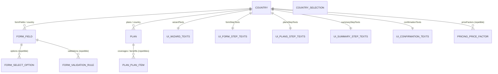

# Modelo de contenido de Strapi

| Campo | Valor |
|---|---|
| Estado | Proposed (G3) |
| Fecha | 2026-11-22 |
| Autor | Software Architect (subagente) |
| Decisiones | D3, D4, D8 · G2-1, G2-2, G2-4, G2-6, G2-7, G2-8 · ADR-0001, ADR-0002, ADR-0003, ADR-0005, ADR-0006 |
| Versión de Strapi | 5.63.0 (SQLite) |

Los nombres de este documento son **los definitivos** que usarán el Strapi Developer y el Angular Developer: sustituyen a los nombres orientativos de las specs. Los atributos están en camelCase (inglés, `CLAUDE.md` §11). `locale`, `status`, `meta` y `document` están reservados en Strapi 5 y no se usan.

## 1. Resumen

| UID | Tipo | Draft & Publish | i18n | Ruta pública |
|---|---|---|---|---|
| `api::country.country` | Collection type (`countries`) | Sí | No | `GET /api/countries` |
| `api::form-field.form-field` | Collection type (`form-fields`) | Sí | No | `GET /api/form-fields` |
| `api::plan.plan` | Collection type (`plans`) | Sí | No | `GET /api/plans` |
| `api::country-selection.country-selection` | Single type (`country-selection`) | Sí | No | `GET /api/country-selection` |

Componentes: `form.select-option`, `form.validation-rule`, `plan.plan-item`, `pricing.price-factor`, `ui.wizard-texts`, `ui.form-step-texts`, `ui.plans-step-texts`, `ui.summary-step-texts`, `ui.confirmation-texts`.

**"Obligatorio"** en las tablas = `required: true` en el esquema de Strapi, que el admin comprueba al publicar. La app **valida igualmente** cada dato (tablas 5.3 de US-01 y REQ-02.25), porque el contrato puede cambiar y los e2e simulan datos imposibles por intercepción (ADR-0007).

## 2. Content types

### 2.1 `country` (collection type)

Datos del mercado, textos de interfaz, factores de precio y términos de un país (ADR-0001).

| Atributo | Tipo | Obligatorio | Restricciones | Uso (REQ) |
|---|---|---|---|---|
| `code` | string | Sí | `unique: true`, `regex: ^[a-z]{2}$` | Segmento de URL, filtro, claves de almacenamiento, prefijo del número de cotización (REQ-01.1, REQ-03.26) |
| `name` | string | Sí | `maxLength: 60` | Lista de `/` y "país no disponible" (REQ-01.2) |
| `intlLocale` | string | Sí | `regex: ^[a-z]{2}-[A-Z]{2}$` (p. ej. `es-CO`) | `Intl.NumberFormat` y `Intl.DateTimeFormat`, `localeCompare` (REQ-02.4, REQ-02.6, REQ-03.3) |
| `currency` | string | Sí | `regex: ^[A-Z]{3}$` (ISO 4217) | Formato y coincidencia con la moneda del plan (REQ-02.6, REQ-02.7) |
| `minimumAge` | integer | Sí | `min: 0`, `max: 120` (seed 18) | Mayoría de edad (REQ-01.20, G2-4) |
| `wizardTexts` | component `ui.wizard-texts` (single) | Sí | — | Textos comunes (§3.5) |
| `formStepTexts` | component `ui.form-step-texts` | Sí | — | Paso 1 (REQ-01.13) |
| `plansStepTexts` | component `ui.plans-step-texts` | Sí | — | Paso 2 (REQ-02.32) |
| `summaryStepTexts` | component `ui.summary-step-texts` | Sí | — | Paso 3 (REQ-03.38) |
| `confirmationTexts` | component `ui.confirmation-texts` | Sí | — | Confirmación (REQ-03.27, REQ-03.38) |
| `priceFactors` | component `pricing.price-factor` (repeatable) | No | Orden = orden del array | Regla de precio (ADR-0005, REQ-02.9) |
| `termsAndConditions` | blocks (Rich text Blocks) | No | — | Términos (ADR-0006, REQ-03.15). Vacío → "términos no disponibles" (REQ-03.18) |
| `formFields` | relation `oneToMany` → `form-field` (`mappedBy: country`) | — | — | Solo navegación en el admin; la app no la puebla |
| `plans` | relation `oneToMany` → `plan` (`mappedBy: country`) | — | — | Igual que `formFields` |

- `code` único garantiza un solo país, y por tanto un solo texto de términos, por código (Q-03.12).
- Despublicar un `Country` lo convierte en "país no disponible" (REQ-01.2).

### 2.2 `form-field` (collection type)

Un campo del formulario del paso 1 de un país. Los atributos son los del PDF (label, type, required, validations, help text, error message, order, country) más los aprobados en G2.

| Atributo | Tipo | Obligatorio | Restricciones | Uso (REQ) |
|---|---|---|---|---|
| `key` | string | Sí | `unique: true`, `regex: ^[a-z][a-zA-Z0-9_]{0,49}$` | Identificador técnico estable, clave de persistencia (Q-01.13, REQ-01.26). Ver §5.1 |
| `label` | string | Sí | `maxLength: 120` | `<label>` (REQ-01.9) |
| `type` | enumeration | Sí | `text`, `number`, `select`, `date`, `checkbox` | Control (REQ-01.10) |
| `required` | boolean | No | `default: false` | REQ-01.14 |
| `helpText` | text | No | — | `aria-describedby` (REQ-01.9) |
| `errorMessage` | string | No | `maxLength: 200` | Único mensaje del campo; vacío → mensaje genérico del país (REQ-01.16) |
| `order` | integer | No | — | Orden dentro de la sección; vacío al final (REQ-01.8) |
| `section` | enumeration | Sí | `policyholder`, `vehicle` | Grupo (REQ-01.12, G2-6) |
| `role` | enumeration | No | `documentNumber`, `birthDate`, `vehicleYear` | Reglas, precio y enmascarado (REQ-01.28, G2-1) |
| `options` | component `form.select-option` (repeatable) | No | Orden = orden del array | Opciones de `select` (REQ-01.11) |
| `validations` | component `form.validation-rule` (repeatable) | No | — | Catálogo G2-7 (REQ-01.15, ADR-0002) |
| `country` | relation `manyToOne` → `country` (`inversedBy: formFields`) | (ver nota) | — | Filtro por país (REQ-01.1) |

- Strapi no permite marcar una relación como obligatoria. Un campo sin país no aparece en ningún país.
- Compatibilidad entre rol y tipo (5.2 de US-01): `documentNumber` → `text`, `birthDate` → `date`, `vehicleYear` → `number`. El admin no la impone; el mapper ignora el rol incompatible con aviso.
- `options` solo tiene sentido en `select`, y `validations` solo admite los `kind` del tipo (§3.2). Lo demás se ignora con aviso (5.3).

### 2.3 `plan` (collection type)

| Atributo | Tipo | Obligatorio | Restricciones | Uso (REQ) |
|---|---|---|---|---|
| `name` | string | Sí | `maxLength: 80` | REQ-02.3 |
| `shortDescription` | text | No | `maxLength: 300` | REQ-02.3, REQ-03.4 |
| `basePrice` | integer | Sí | `min: 1` (unidades enteras de la moneda) | REQ-02.8, ADR-0005 |
| `currency` | string | Sí | `regex: ^[A-Z]{3}$` | Debe coincidir con `country.currency` (REQ-02.7) |
| `coverages` | component `plan.plan-item` (repeatable) | No | Orden = orden del array | REQ-02.3 |
| `benefits` | component `plan.plan-item` (repeatable) | No | Orden = orden del array | REQ-02.3 |
| `order` | integer | No | — | REQ-02.4 |
| `recommended` | boolean | No | `default: false` | REQ-02.5 |
| `active` | boolean | No | `default: false` | Solo `true` se muestra (REQ-02.2) |
| `country` | relation `manyToOne` → `country` (`inversedBy: plans`) | (ver nota de 2.2) | — | REQ-02.1 |

`active` vale `false` por defecto: un plan nuevo no aparece hasta que el negocio lo activa *y* lo publica (dos decisiones explícitas).

### 2.4 `country-selection` (single type)

Contenido global de la página `/`, no ligado a ningún país (REQ-01.2, G2-3; ADR-0001 opción B1).

| Atributo | Tipo | Obligatorio | Uso |
|---|---|---|---|
| `heading` | string | Sí | `<h1>` y `document.title` de `/` |
| `intro` | text | No | Párrafo opcional bajo el encabezado |
| `countryListLabel` | string | Sí | Nombre accesible de la lista o navegación de países |

## 3. Componentes

### 3.1 `form.select-option`

| Atributo | Tipo | Obligatorio | Restricciones |
|---|---|---|---|
| `value` | string | Sí | `regex: ^[A-Za-z0-9_-]{1,64}$`. Valor estable que se persiste (REQ-01.11) |
| `label` | string | Sí | `maxLength: 120`. Texto visible y `displayValue` del resumen (REQ-03.3) |

Un `value` repetido dentro del mismo campo se trata como opción inválida y se queda la primera.

### 3.2 `form.validation-rule`

| Atributo | Tipo | Obligatorio | Notas |
|---|---|---|---|
| `kind` | enumeration | Sí | `minLength`, `maxLength`, `pattern`, `min`, `max`, `integer` |
| `value` | decimal | No | Parámetro de `minLength`, `maxLength` (entero ≥ 0), `min` y `max` |
| `pattern` | string | No | `maxLength: 500`. Expresión regular **sin** `^`/`$` (la app la ancla a todo el valor) |

Validez (la comprueba el mapper; si no se cumple, la regla se ignora con aviso):

| `kind` | Tipo de campo | Parámetro |
|---|---|---|
| `minLength`, `maxLength` | `text` | `value` entero ≥ 0 |
| `pattern` | `text` | `pattern` que compila como `RegExp` |
| `min`, `max` | `number` | `value` finito; si hay los dos, `min ≤ max` |
| `integer` | `number` | Ninguno |

### 3.3 `plan.plan-item`

| Atributo | Tipo | Obligatorio |
|---|---|---|
| `label` | string | Sí (`maxLength: 200`) |

### 3.4 `pricing.price-factor`

Ver ADR-0005 y [`pricing-rule.md`](pricing-rule.md).

| Atributo | Tipo | Obligatorio | Notas |
|---|---|---|---|
| `role` | enumeration | Sí | `vehicleYear`, `birthDate` |
| `operand` | enumeration | Sí | `vehicleAge`, `ageInYears` |
| `min` | integer | No | Vacío = sin límite |
| `max` | integer | No | Vacío = sin límite |
| `multiplier` | decimal | Sí | > 0 y finito (REQ-02.12) |

### 3.5 Textos de interfaz (`ui.*`)

Todos son `string` (o `text` cuando se indica), **obligatorios**, y se cargan una vez por carga de la app con el país (C3 en api-contracts). Los únicos textos en código son "cargando", "error de carga", "reintentar" y "país no disponible" (G2-2).

**`ui.wizard-texts`**

| Atributo | Uso | REQ |
|---|---|---|
| `stepIndicatorLabel` | Nombre accesible del indicador de pasos | REQ-01.31 |
| `step1Label`, `step2Label`, `step3Label` | Nombres de los pasos en el indicador | REQ-01.31 |
| `policyholderSectionLabel` | Leyenda de la sección asegurado (paso 1 y resumen) | REQ-01.12, REQ-03.2 |
| `vehicleSectionLabel` | Leyenda de la sección vehículo (paso 1 y resumen) | REQ-01.12, REQ-03.2 |
| `genericErrorMessage` (text) | Mensaje de error genérico del país | REQ-01.13, REQ-02.32, REQ-03.38 |

**`ui.form-step-texts`**: `title`, `continueLabel`, `emptyMessage` (text). REQ-01.5, REQ-01.13.

**`ui.plans-step-texts`**: `title`, `groupLegend`, `recommendedLabel`, `coveragesHeading`, `benefitsHeading`, `backLabel`, `continueLabel`, `choosePlanMessage`, `emptyMessage` (text), `planUnavailableMessage` (text). REQ-02.5, REQ-02.15, REQ-02.17, REQ-02.22, REQ-02.32.

**`ui.summary-step-texts`**

| Atributo | Sección del resumen (REQ-03.38) |
|---|---|
| `title` | Página |
| `editDataLabel`, `yesLabel`, `noLabel`, `emptyValueLabel` (seed "—") | Datos |
| `planHeading`, `changePlanLabel`, `finalPriceLabel` | Plan (usa además `coveragesHeading` y `benefitsHeading` de `plansStepTexts`) |
| `termsHeading`, `acceptTermsLabel`, `acceptTermsHint`, `termsUnavailableMessage` (text) | Términos |
| `gatewayLegend`, `approvedOptionLabel`, `rejectedOptionLabel`, `payLabel`, `processingMessage`, `rejectedMessage` (text) | Pago simulado (REQ-03.21, REQ-03.30, REQ-03.35) |

**`ui.confirmation-texts`**: `title`, `quoteNumberLabel`, `planLabel`, `paidPriceLabel`, `newQuoteLabel`. REQ-03.27.

**Texto ausente** (al llegar por intercepción o por un cambio de contrato): el mapper marca la pantalla o la sección afectada como `configError`. Se muestra `genericErrorMessage` y, si también falta, "error de carga" + "reintentar" (REQ-01.13, REQ-02.32, REQ-03.38, F-00.7).

## 4. Permisos del rol público

Los aplica `bootstrap` en cada arranque, de forma idempotente: concede estos y **revoca cualquier otro** (ADR-0003).

| Permiso | Motivo | Peticiones (api-contracts) |
|---|---|---|
| `api::country.country.find` | Lista de países, configuración del país, factores, términos | C1, C3, C6, C7 |
| `api::form-field.form-field.find` | Campos del paso 1 | C4 |
| `api::plan.plan.find` | Planes del paso 2 y del resumen | C5 |
| `api::country-selection.country-selection.find` | Textos de `/` | C2 |

- Sin `findOne`, `create`, `update` ni `delete` en ningún tipo. Sin permisos de `upload`, `users-permissions` (`auth.*`, `user.*`, `role.*`) ni `i18n`. "Enable sign-ups" desactivado.
- Los routers de los cuatro tipos referencian `global::published-only` en `find` (ADR-0003): fuerza `status=published` y elimina `publicationFilter`.
- El rol `authenticated` no tiene permisos.
- El token de e2e (ADR-0003) no es un permiso del rol público: es un token de API Custom creado en el admin.

## 5. Decisiones del modelo que necesitan confirmación (G3)

### 5.1 Unicidad de `key` por país (Q-01.13)

Strapi solo ofrece `unique` sobre toda la colección; no admite unicidad compuesta (`country` + `key`).

| Opción | A favor | En contra |
|---|---|---|
| **A. `unique: true` global + convención de prefijo por país** (`co_documentNumber`, `cl_documentNumber`) **(recomendada)** | Lo impone Strapi sin código; el admin avisa al guardar; las claves no son visibles para el usuario y el almacenamiento ya está separado por país | Prefijo por convención (no lo impone la regex); al copiar campos a un país nuevo hay que renombrar las claves |
| B. Validación propia `(country, key)` en un middleware del Document Service | Unicidad exacta por país, sin prefijos | Código propio que interpreta el formato de las relaciones al guardar (`connect`, `documentId`), frágil entre versiones |
| C. Solo la defensa de la app (5.3: se queda el primero por `order`) | Cero trabajo en Strapi | El negocio no recibe aviso; un campo desaparece en silencio (solo un aviso en consola) |

La defensa de la app (C) se mantiene en cualquier caso, porque la exige la spec.

### 5.2 Textos obligatorios en Strapi

Recomendado: `required: true` (el negocio no puede publicar un país con textos vacíos). Consecuencia: AC-01.35, AC-02.33 y AC-03.36 se verifican por intercepción y no con un cambio real en Strapi. La alternativa (textos opcionales en Strapi) permite reproducirlos con un cambio real, pero deja publicar un país que muestra el mensaje genérico en lugar del formulario.

### 5.3 Leyendas de sección compartidas

Recomendado: las leyendas `policyholderSectionLabel` y `vehicleSectionLabel` son las mismas en el paso 1 y en el resumen. Si el negocio quiere textos distintos en el resumen, se añaden dos atributos a `ui.summary-step-texts` (caso B).

### 5.4 "—" para un opcional vacío (REQ-03.3)

Recomendado: viene de Strapi (`emptyValueLabel`, seed "—"), para cumplir G2-2 al pie de la letra. La alternativa es tratarlo como símbolo fijo en código, lo que exigiría ampliar la excepción de G2-2.

## 6. Seed (requisitos para el Strapi Developer)

Ubicación: `cms/src/seed/` (`data/co.ts`, `data/cl.ts`, `seed.ts`, `permissions.ts`), invocado desde `bootstrap` en `cms/src/index.ts`. Es idempotente: crea lo que no existe, buscando por `code`, por `key` o por `name` de plan dentro del país, y **no sobrescribe** lo que el negocio haya cambiado.

| País | Contenido mínimo | REQ |
|---|---|---|
| CO y CL | `Country` publicado con `intlLocale`, `currency`, `minimumAge: 18`, todos los textos y términos (párrafos y una lista) | REQ-01.34, REQ-02.33, REQ-03.15 |
| CO | Campos: tipo de documento (`select`: cédula de ciudadanía y cédula de extranjería), número de documento (`text`, rol `documentNumber`, `pattern` que admite CC y CE), placa (`text`), marca y ciudad (`select`), fecha de nacimiento (`date`, rol `birthDate`), año del vehículo (`number`, rol `vehicleYear`, `integer`), aceptación de tratamiento de datos (`checkbox`, obligatorio) | REQ-01.34 |
| CL | Igual que CO con RUT (`text`, rol `documentNumber`) y patente en lugar de placa | REQ-01.34 |
| CO y CL | 3 planes publicados y activos (orden y precio distintos, exactamente 1 recomendado), 1 publicado e inactivo, 1 en borrador | REQ-02.33 |
| CO y CL | `priceFactors` con las bandas de US-02 §6.3 | REQ-02.33 |
| Global | `country-selection` publicado | REQ-01.2 |

Todos los datos son ficticios (`CLAUDE.md` §6). Las claves siguen la convención de §5.1 si se aprueba la opción A.

## 7. Qué cambia el negocio sin código (caso A) y qué no (caso B)

| Sin código (Strapi) | Con código (caso B o C) |
|---|---|
| Añadir, quitar, publicar, despublicar o reordenar campos; cambiar label, ayuda, error, sección, rol (de los 3), `required`; validaciones del catálogo y sus parámetros; opciones de `select` | Tipo de campo nuevo; `kind` de validación nuevo; rol nuevo; sección nueva |
| Planes: alta, baja, activar, orden, recomendado, precio base, coberturas, beneficios | Moneda con decimales (ADR-0005) |
| Factores: bandas, multiplicadores, orden, rol de los existentes | Operando nuevo |
| Términos y todos los textos de interfaz existentes | Texto de interfaz nuevo |
| Edad mínima, locale y moneda de un país; publicar un país nuevo con sus campos y planes | Límites del año del vehículo (fijos por G2-4) |
