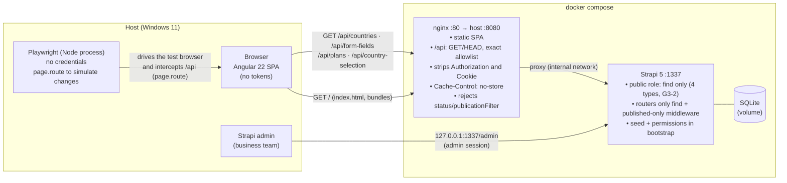
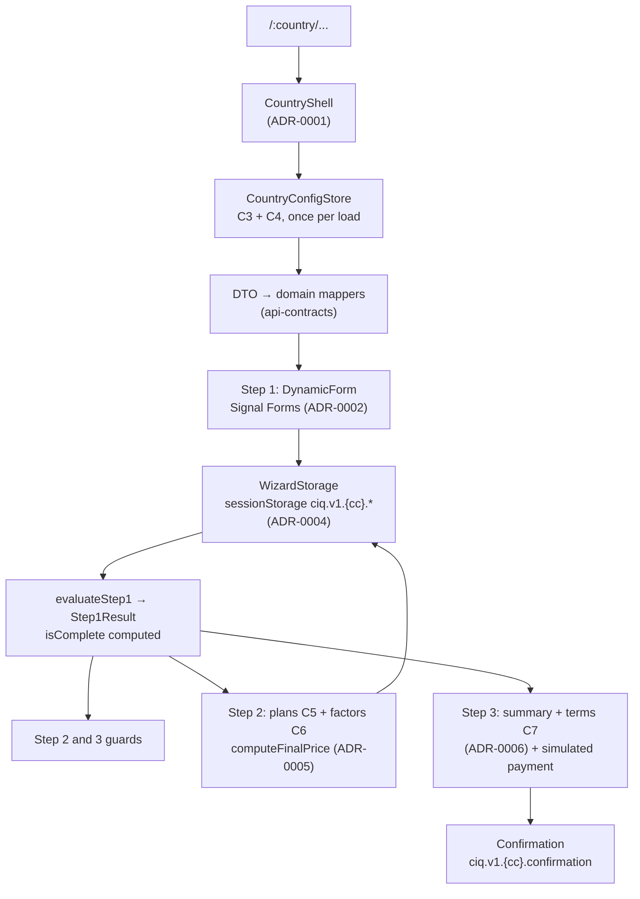

# Architecture overview

| Field | Value |
|---|---|
| Status | Accepted (2026-11-22, G3) |
| Date | 2026-11-22 |
| Author | Software Architect (subagent) |
| ADRs | [0001](../adr/0001-multi-country-strategy.md) multi-country · [0002](../adr/0002-dynamic-form-with-signal-forms.md) form · [0003](../adr/0003-strapi-access-and-security.md) access and security · [0004](../adr/0004-wizard-state-persistence-and-navigation.md) state and navigation · [0005](../adr/0005-configurable-price-rule.md) price · [0006](../adr/0006-terms-rich-text-safe-rendering.md) terms · [0007](../adr/0007-test-strategy.md) tests |
| Documents | [content-model.md](content-model.md) · [api-contracts.md](api-contracts.md) · [pricing-rule.md](pricing-rule.md) |

Stack: Angular 22.3 (standalone, signals, zoneless, Signal Forms) · Strapi 5.63 (SQLite) · nginx · Node 24.22.3 · Vitest (jsdom) · Playwright 1.65.1 (`channel: 'chrome'`) · Docker Compose v5. **No dependencies are added** beyond those that Angular CLI, Strapi and Playwright bring by default.

## 1. Components



Data flow in the browser:



## 2. Folder structure

File names follow the Angular 22 style (`ng generate`: kebab-case, no `.component` suffix). Organized by feature, with no folders per code type (angular.dev style guide). Each `*.ts` file with logic has its `*.spec.ts` next to it.

### `frontend/` (Angular Developer)

```
frontend/
├── angular.json · package.json · tsconfig*.json
├── proxy.conf.json                  # ng serve: /api → http://localhost:8080 (nginx)
└── src/
    ├── index.html · main.ts · styles.css
    └── app/
        ├── app.ts · app.html · app.config.ts · app.routes.ts   # global navigation "cargando" indicator
        ├── core/
        │   ├── cms/                 # cms-client.ts (GET, timeout, pagination), strapi-dto.ts,
        │   │                        # country-mapper.ts, form-field-mapper.ts, plan-mapper.ts,
        │   │                        # price-factor-mapper.ts, terms-mapper.ts
        │   ├── country/             # country-context.ts, country-config-store.ts, country-case-guard.ts
        │   ├── storage/             # wizard-storage.ts (WIZARD_STORAGE, keys ciq.v1.{cc}.*)
        │   ├── clock/               # clock.ts (CLOCK, todayLocal)
        │   └── ui-state/            # fixed-texts.ts (the 4 texts of G2-2), view-state.ts
        ├── domain/                  # shared pure functions
        │   ├── dates/               # age-in-years.ts, legal-age.ts, vehicle-year.ts
        │   ├── pricing/             # compute-final-price.ts, format-price.ts
        │   ├── masking/             # mask-document.ts (REQ-03.7)
        │   └── quote-number/        # create-quote-number.ts (REQ-03.26)
        ├── shared/                  # status-message.ts (role=status/alert), step-heading.ts
        └── features/
            ├── country-selection/   # country-selection-page.ts, country-not-available.ts
            ├── wizard-shell/        # country-shell.ts, step-indicator.ts
            ├── form-step/           # form-step-page.ts, dynamic-form.ts, step1-schema.ts,
            │   └── validation/      # validator-registry.ts, text-rules.ts, number-rules.ts,
            │                        # reconcile-step1.ts, evaluate-step1.ts, step1-complete-guard.ts
            ├── plans-step/          # plans-step-page.ts, sort-plans.ts, plan-selection.ts
            ├── summary-step/        # summary-step-page.ts, summary-values.ts, plan-selected-guard.ts
            │   ├── terms/           # terms-blocks.ts (rendering without innerHTML)
            │   └── payment/         # mock-payment-gateway.ts (PAYMENT_DELAY_MS)
            └── confirmation/        # confirmation-page.ts, confirmation-guard.ts
```

### `cms/` (Strapi Developer)

```
cms/
├── Dockerfile                       # node:24-*-slim; node_modules inside the image
├── package.json · tsconfig.json
├── config/
│   ├── api.ts                       # rest.defaultLimit 25, rest.maxLimit 100
│   ├── database.ts                  # SQLite on a volume
│   ├── middlewares.ts · server.ts · admin.ts · plugins.ts
└── src/
    ├── index.ts                     # bootstrap: public permissions + seed (idempotent)
    ├── middlewares/
    │   └── published-only.ts        # forces status=published (ADR-0003)
    ├── api/
    │   ├── country/                 # content-types/country/schema.json, routes/country.ts,
    │   │                            # controllers/, services/
    │   ├── form-field/              # same
    │   ├── plan/                    # same
    │   └── country-selection/       # same (single type)
    ├── components/
    │   ├── form/                    # select-option.json, validation-rule.json
    │   ├── plan/                    # plan-item.json
    │   ├── pricing/                 # price-factor.json
    │   └── ui/                      # wizard-texts.json, form-step-texts.json, plans-step-texts.json,
    │                                # summary-step-texts.json, confirmation-texts.json
    └── seed/
        ├── seed.ts · permissions.ts
        └── data/                    # co.ts, cl.ts, country-selection.ts
```

### Other folders

```
infra/nginx/                         # Strapi Developer (G1-d): default.conf, Dockerfile (Angular build + nginx)
e2e/                                 # QA Engineer: playwright.config.ts, fixtures/ (network-guard.ts, cms-route.ts:
                                     # page.route + route.fetch helpers), tests/ (flow, states, content-changes
                                     # by interception, a11y-responsive). No credentials (G3-3)
docker-compose.yml · .env.example    # Strapi Developer (G1-d)
```

`infra/` does not appear in the structure of `CLAUDE.md` §5. It is the proposed location for nginx, because G1-d assigns nginx to the Strapi Developer and `frontend/` belongs to the Angular Developer. If the human prefers another path (e.g. `cms/nginx/`), only this section changes.

## 3. Coverage of REQs with technical impact

| REQ | Where it is decided |
|---|---|
| REQ-01.1, REQ-01.2, REQ-01.25 | ADR-0001; api-contracts C1–C3 |
| REQ-01.3, REQ-01.4, REQ-01.5, REQ-01.32 | ADR-0004 (states); api-contracts §1 |
| REQ-01.6 | ADR-0003 (caching, `published-only`); ADR-0004 (nothing persisted) |
| REQ-01.7, REQ-01.8 | api-contracts C4 (mapper and order) |
| REQ-01.9 to REQ-01.12 | content-model §2.2 and §3.1; ADR-0002 |
| REQ-01.13 | content-model §3.5; ADR-0001 (C1) |
| REQ-01.14 to REQ-01.17, REQ-01.22, REQ-01.29, REQ-01.30 | ADR-0002 |
| REQ-01.18, REQ-01.31 | ADR-0001 (routes); ADR-0004 (focus and navigation) |
| REQ-01.19 to REQ-01.21 | ADR-0002 (role rules); ADR-0007 (determinism) |
| REQ-01.23, REQ-01.24, REQ-01.26, REQ-01.27 | ADR-0004 |
| REQ-01.28 | ADR-0001 (roles); content-model §2.2 |
| REQ-01.34 | content-model §6 |
| REQ-01.35 | ADR-0003 |
| REQ-02.1, REQ-02.2, REQ-02.4, REQ-02.5, REQ-02.7, REQ-02.24, REQ-02.25 | api-contracts C5 |
| REQ-02.3 | content-model §2.3 |
| REQ-02.6, REQ-02.8 to REQ-02.13 | ADR-0005; pricing-rule.md |
| REQ-02.16 to REQ-02.22, REQ-02.30 | ADR-0004 |
| REQ-02.23, REQ-02.31 | ADR-0003; ADR-0004 |
| REQ-02.32, REQ-02.33 | content-model §3.5 and §6 |
| REQ-03.1 to REQ-03.3 | ADR-0004 (`Step1Result`); content-model §3.5 |
| REQ-03.4, REQ-03.5 | ADR-0005 |
| REQ-03.9 to REQ-03.14, REQ-03.19, REQ-03.21 to REQ-03.32, REQ-03.37 | ADR-0004 |
| REQ-03.15 to REQ-03.18 | ADR-0006; content-model §2.1; api-contracts C7 |
| REQ-03.20 | ADR-0003; ADR-0004 |
| REQ-03.38 | content-model §3.5 (text per section) |

**No architecture decision** (direct implementation of the spec and of `CLAUDE.md` §8, with no alternatives to decide): REQ-01.33, REQ-02.14, REQ-02.15, REQ-02.26 to REQ-02.29, REQ-03.6 to REQ-03.8 (pure function already specified in REQ-03.7; only its location is set, `domain/masking/`), REQ-03.33 to REQ-03.36.

## 4. `country-content` Skill: unblocked parts

| Skill step | Before ("pending G3") | Now |
|---|---|---|
| Case A.3 (seed) | Seed path | `cms/src/seed/data/{co,cl}.ts`, idempotent, does not overwrite admin changes |
| Case B.2 (Strapi) | Enum or component | Field type: enum `form-field.type`. Validation: enum `form.validation-rule.kind`. Role: enum `form-field.role` (and `pricing.price-factor.role` if the price uses it). Operand: enum `pricing.price-factor.operand`. Interface text: attribute in `ui.*` |
| Case B.3 (Angular) | DTO → mapper → domain → registry | `core/cms/strapi-dto.ts` → `core/cms/form-field-mapper.ts` (tables of api-contracts C4) → types of api-contracts §3 → `features/form-step/validation/validator-registry.ts` (pure function + `AC-…` test) |
| Case C.2 (new country) | `Country` entry and content | `country` with `code`, `name`, `intlLocale`, `currency`, `minimumAge`, the 5 `ui.*` components, `priceFactors`, `termsAndConditions`, plus related `form-field` and `plan`, all published |
| Common checks | No names | `Intl` with `country.intlLocale` and `country.currency`; keys `ciq.v1.{cc}.*`; reconciliation in `reconcile-step1.ts` |

Still pending (not part of G3): updating the Skill text with these names once the ADRs are accepted. The orchestrator does it, because `.claude/skills/` is outside the architect's paths.

## 5. References

Consulted on 2026-11-22:

- Angular style guide (kebab-case, organization by feature): https://angular.dev/style-guide
- The rest of the references are in each ADR and in content-model and api-contracts.

> Translated into English on 2026-11-23 (D16); no content change.
